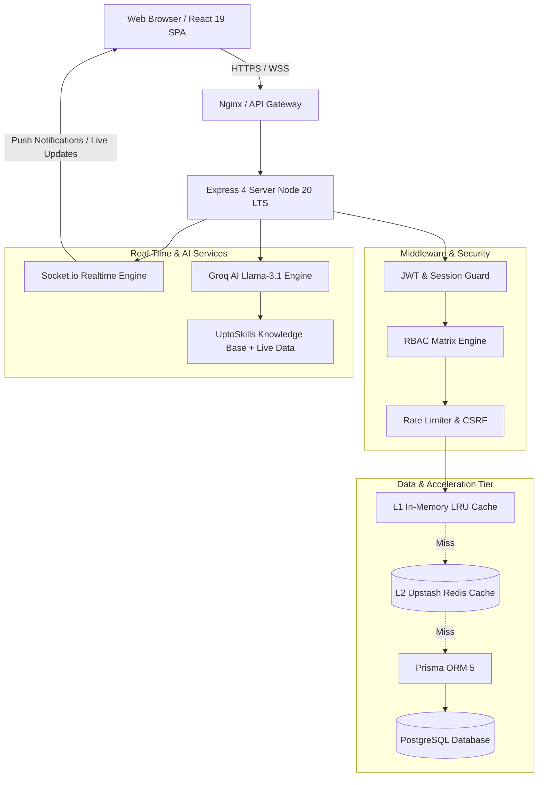
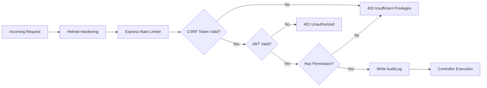

# <div align="center">✨ SkillNova IMS (Intern Management System) ✨</div>

<div align="center">


<p align="center">
  <b>A next-generation, production-grade enterprise Internship Management System built for UptoSkills.</b><br/>
  Featuring 4-tier granular Role-Based Access Control (RBAC), multi-factor authentication (TOTP & OTP), real-time WebSocket telemetry, interactive Kanban boards, dual-layer caching, and a context-aware AI Mentor grounded directly on live platform data and curated program guides.
</p>

[Explore Key Highlights](#-key-highlights) •
[System Architecture](#-system-architecture) •
[Features & Functionalities](#-comprehensive-features--functional-breakdown) •
[Role Matrix](#-granular-role-based-access-control-rbac) •
[Quick Start](#-quick-start-guide) •
[API Surface](#-rest-api-surface) •
[Security & Observability](#-security--observability)

</div>

---

## 🌟 Executive Overview

**SkillNova IMS** transforms how modern organizations manage, mentor, track, and evaluate interns. Going far beyond traditional HR portals or spreadsheet logging, SkillNova offers an end-to-end digital lifecycle: from onboarding and verification, daily task and progress tracking, real-time mentorship and project reviews, to AI-driven query resolution and automated platform analytics.

### Why SkillNova IMS Stands Out:
* 🛡️ **Enterprise Security First**: True two-factor authentication (TOTP/App + Email OTP), signed HMAC URLs, CSRF double-submit cookies, audit logging on all mutating endpoints, and rate-limiting.
* ⚡ **Blazing Fast Performance**: 2-tier caching engine combining ultra-low-latency in-memory LRU with distributed Upstash Redis. Sub-5ms response times on hot routes (`~1300x` speedup).
* 🤖 **Domain-Grounded AI Assistant**: An intelligent co-pilot powered by Groq and Llama 3.1 that searches the platform's verified knowledge base and live workspace data before falling back to general LLM intelligence.
* 🎯 **Dedicated Role Shells**: Tailor-made, responsive workspaces for `SUPER_ADMIN`, `ADMIN`, `MENTOR`, and `INTERN`.
* 📊 **Insightful Operations**: Live Kanban pipelines, attendance geolocation/check-in logging, dynamic reports, platform-wide analytics, and audit logs.

---

## 🏛️ System Architecture

SkillNova is architected as an optimized monorepo combining an Express REST & Realtime API backend with a high-performance React 19 single-page application.



---

## 💻 Tech Stack & Engineering Specifications

### 🛠️ Backend Stack
| Layer / Tool | Technology | Purpose & Implementation Details |
| :--- | :--- | :--- |
| **Runtime** | `Node.js 20 LTS` | Pinned via `.nvmrc` for consistent execution across environments. |
| **API Framework** | `Express 4` | Modular route controllers, custom global error handling (`ApiError`). |
| **Database & ORM** | `PostgreSQL` + `Prisma 5` | Strongly typed schema with relations, migrations, and automated seeding. |
| **Caching Engine** | `In-Memory LRU + Upstash Redis` | L1 in-memory LRU with request coalescing (`lru.wrap`) and distributed L2 Redis fallback. |
| **Real-time Engine** | `Socket.io 4` | Role-based and user-specific rooms for instant notifications and events. |
| **Artificial Intelligence** | `Groq Cloud (Llama 3.1)` | Low-latency inference (`llama-3.1-8b-instant` / `70b-versatile`) with Server-Sent Events (SSE). |
| **Authentication & 2FA** | `JWT + Speakeasy + Crypto` | Access tokens (15m), Refresh tokens (30d), TOTP 2FA, OTP fallback. |
| **Security & Hardening** | `Helmet + CORS + RateLimit` | Strict HTTP security headers, origin whitelisting, double-submit CSRF protection. |
| **Telemetry & Logging** | `Pino + Custom RequestID` | JSON structured logs in production, ISO timestamps, `x-request-id` header tracing. |

### 🎨 Frontend Stack
| Layer / Tool | Technology | Purpose & Implementation Details |
| :--- | :--- | :--- |
| **Core Framework** | `React 19` | Modern concurrent rendering, clean hook architectures. |
| **Build Tool** | `Vite 8` | Lightning-fast HMR and custom vendor code splitting (`vendor-react`, `vendor-charts`, etc.). |
| **Styling & Theme** | `Tailwind CSS` + Custom CSS Tokens | Clean modern palette, glassmorphism UI, light/dark mode support. |
| **State Management** | `Zustand` | Lightweight, scalable global stores for authentication, active workspace, and UI theme. |
| **Interactive Kanban** | `@dnd-kit` | Accessible, smooth drag-and-drop task workflow boards. |
| **Data Visualization** | `Recharts` | Dynamic interactive charts for intern performance, attendance trends, and platform metrics. |
| **Motion & Micro-interactions** | `Framer Motion` | Fluid page transitions, modal dialog animations, and status indicators. |
| **UI Components & Icons** | `Lucide React` + `React Hot Toast` | Sleek modern icon system and toast notification alerts. |
| **Markdown Rendering** | `React Markdown + Remark` | Rich-text rendering for Knowledge Base articles and AI assistant output. |

---

## 🚀 Comprehensive Features & Functional Breakdown

### 1. 👥 Multi-Tier User Management & Profiles
* **Role Hierarchy**: Strict separation between `SUPER_ADMIN`, `ADMIN`, `MENTOR`, and `INTERN`.
* **Profile Attributes**: Intern profiles store colleges, departments, year of study, GitHub/LinkedIn links, technology tags, and cumulative ratings.
* **Status Lifecycle**: Account states include `PENDING`, `ACTIVE`, `INACTIVE`, and `SUSPENDED`.
* **User Directory**: Searchable, paginated, and filterable by department, status, and role with fast cached responses.

### 2. 🔐 Authentication, 2FA & Session Security
* **Dual-Token System**: Short-lived Access Tokens (15 min) for secure stateless API access paired with HTTP-only Refresh Tokens (30 days).
* **Two-Factor Authentication (2FA)**:
  * QR Code TOTP enrolment (compatible with Google Authenticator, Authy).
  * Automated fallback to Time-based OTP challenge codes.
  * Developer-friendly test mode (`devCode` exposed in development).
* **Session Revocation**: Selective logout or global "logout-all" invalidating all active refresh tokens in the database.

### 3. 📋 Daily Work Reports & Review Pipeline
* **Submission Workflow**: Interns submit rich daily work logs detailing tasks accomplished, blockers encountered, hours logged, and planned next steps.
* **Review & Grading Cycle**: Mentors and Admins review submitted reports, score performance, and leave constructive review remarks.
* **Automated Scoping**: Role-aware queries automatically filter submissions so interns see their own logs while mentors view assigned groups.

### 4. 📅 Attendance Tracking & Check-In System
* **Self Check-In / Check-Out**: Interns log their working sessions daily with timestamps and optional IP/location verification.
* **Managerial Attendance**: Mentors and Admins can view roll-up attendance sheets, override attendance statuses, and mark excused absences.
* **Attendance Analytics**: Real-time aggregation of attendance percentages, leaves, and trends.

### 5. 🗂️ Collaborative Kanban & Task Management
* **Visual Project Flow**: Drag-and-drop Kanban boards with custom swimlanes (`Backlog`, `In Progress`, `Under Review`, `Done`).
* **Task Assignment**: Assign tasks to specific interns, establish deadlines, set priorities (`Low`, `Medium`, `High`, `Urgent`), and attach requirement links.
* **Live Synchronization**: Updates reflect in real time via Socket.io events across connected clients.

### 6. 📚 Knowledge Base (KB) with Full Versioning
* **Curated Repository**: Comprehensive repository of internship guides, setup manuals, standards, and tutorials.
* **Article Version History**: Every edit creates a new `KnowledgeArticleVersion`, allowing rollback and audit tracking of instructional documentation.
* **Verification Badge**: Admins can officially "Verify" articles, providing interns confidence in approved company documentation.
* **Feedback Loop**: One-click "Helpful / Not Helpful" feedback widget on articles to identify documentation gaps.

### 7. 🤖 Grounded AI Co-Pilot (Groq + Llama 3.1)
* **Tiered Context Grounding**:
  1. *Priority 1*: Internal **UptoSkills Knowledge Base** (`uptoskills.kb.js`) covering program policies, schedules, codes of conduct, and workflows.
  2. *Priority 2*: **Live Platform Context** pulling real-time platform data (recent announcements, student reports, KB articles).
  3. *Priority 3*: General Llama 3.1 reasoning for coding and technical inquiries.
* **Real-Time Streaming**: Server-Sent Events (SSE) streaming delivering fast time-to-first-token responses without proxy buffering.
* **Chat Session Persistence**: Retains multi-turn conversation histories organized into restorable sessions.

### 8. 📢 Announcements & Real-Time Broadcasts
* **Targeted Broadcasts**: Post announcements platform-wide or target specific roles (`MENTOR`, `INTERN`).
* **Pinning & Read Tracking**: Important notices can be pinned to the top of intern dashboards; tracks read receipts per user.
* **Instant Delivery**: Dispatched over WebSockets for immediate display without page reloads.

### 9. 💬 Community Q&A Forum
* **Peer & Mentor Discussion**: StackOverflow-style Q&A platform for asking technical questions and seeking guidance.
* **Upvoting & Best Answer**: Community members can upvote helpful questions and answers; the original question author can mark the accepted answer.

### 10. 📁 Secure File Management & Downloads
* **Restricted Uploads**: Validated file uploads (PDFs, images, archives) up to 25 MB with MIME type enforcement.
* **HMAC Signed URLs**: Direct file paths are shielded; downloads generate short-lived, cryptographically signed URLs.

### 11. 🔔 Intelligent Notification Dispatcher
* **Central Inbox**: In-app notifications with badge counters, unread filters, and one-click "Mark All as Read".
* **Preference Engine**: Interns and mentors can customize notification preferences and set quiet hours.

### 12. 📈 Executive Analytics & Data Exports
* **Live Dashboards**: Interactive charts visualizing active users, report completion rates, top-performing interns, and project velocity.
* **One-Click Exports**: Download raw platform metrics, user registries, attendance records, and report archives in CSV or JSON format.

### 14. 🔥 Learning Streak & Skill Tracker
* **Gamified Daily Streaks**: Tracks interns' consecutive days of learning and daily submissions with `currentStreak`, `longestStreak`, and automated resets.
* **Daily Learning Logs**: Micro-journaling for interns (`LearningTracker`) to record key concepts mastered each day.

### 15. 📅 Calendar & Interactive Meeting Scheduler
* **Meeting Types**: Native support for `STANDUP`, `ONE_ON_ONE`, `REVIEW`, and `TRAINING` sessions.
* **RSVP & Attendance Tracking**: Track attendee responses (`PENDING`, `ACCEPTED`, `DECLINED`) and calendar sync across role shells.


---

## 🛡️ Granular Role-Based Access Control (RBAC)

SkillNova enforces a strict, fine-grained permission matrix at the controller level:

| Capability / Permission | Super Admin | Admin | Mentor | Intern |
| :--- | :---: | :---: | :---: | :---: |
| **User Directory (`users:read`)** | ✅ | ✅ | ✅ | ❌ |
| **Create / Update Users (`users:create`, `users:update`)** | ✅ | ✅ | ❌ | ❌ |
| **Change User Roles (`users:role:change`)** | ✅ | ❌ | ❌ | ❌ |
| **Delete User (`users:delete`)** | ✅ | ❌ | ❌ | ❌ |
| **Submit Reports (`reports:create`)** | ❌ | ❌ | ✅ | ✅ |
| **Review & Score Reports (`reports:review`)** | ✅ | ✅ | ✅ | ❌ |
| **Create KB Articles (`kb:create`)** | ✅ | ✅ | ✅ | ❌ |
| **Verify / Delete KB Articles (`kb:verify`, `kb:delete`)** | ✅ | ✅ | ❌ | ❌ |
| **Mark Others' Attendance (`attendance:mark`)** | ✅ | ✅ | ✅ | ❌ |
| **Self Check-In Attendance (`attendance:self`)** | ✅ | ✅ | ✅ | ✅ |
| **Publish Announcements (`announcements:create`)** | ✅ | ✅ | ❌ | ❌ |
| **Access Grounded AI (`ai:use`)** | ✅ | ✅ | ✅ | ✅ |
| **Upload Files (`files:upload`)** | ✅ | ✅ | ✅ | ✅ |
| **Manage Webhooks (`webhooks:manage`)** | ✅ | ✅ | ❌ | ❌ |
| **View Platform Analytics (`analytics:read`)** | ✅ | ✅ | ❌ | ❌ |

---

## ⚡ Performance & Caching Benchmarks

SkillNova employs an aggressive, two-tier caching architecture to ensure lightning-fast UI responsiveness even on high-latency database connections:

* **L1 In-Memory LRU**: Sub-millisecond response cache with TTL eviction and in-flight request coalescing (`lru.wrap`).
* **L2 Distributed Cache**: Upstash Redis for distributed cross-instance session and state caching.
* **HTTP ETag Revalidation**: Automatically attaches ETags to every `GET` response, issuing `304 Not Modified` on identical requests.

### 📊 Real Benchmark Measurements (Cold DB vs Hot Cache):

```
Endpoint: /auth/me
  Cold (DB Query):    ████████████████████ 3,400 ms
  Hot (L1/L2 Cache):  ▍ 5 ms  (~700x speedup)

Endpoint: /analytics/platform
  Cold (Aggregation): ████████████████████████ 4,000 ms
  Hot (L1/L2 Cache):  ▍ 3 ms  (~1,300x speedup)

Endpoint: /analytics/interns
  Cold (Aggregated):  █████████████████ 2,900 ms
  Hot (L1/L2 Cache):  ▍ 6 ms  (~500x speedup)
```

---

## 📂 Repository Directory Layout

```
skillnova/
├── 📁 server/                           # Express 4 Backend Engine
│   ├── 📁 prisma/                       # Database Schema & Seed Data
│   │   ├── schema.prisma                # Full PostgreSQL Data Model
│   │   └── seed.js                      # Seed Data & Default Demo Accounts
│   ├── 📁 tests/                        # Node Built-in Test Runner Suite
│   │   ├── ApiError.test.js             # Error handling verification
│   │   ├── auth.test.js                 # JWT, Password & OTP tests
│   │   ├── cache.test.js                # L1/L2 Cache operations
│   │   ├── lru.test.js                  # LRU TTL and request coalescing
│   │   └── rbac.test.js                 # Permission matrix enforcement
│   └── 📁 src/
│       ├── 📁 ai/                       # Groq Integration & UptoSkills Curated KB
│       ├── 📁 config/                   # Zod/Joi Environment Validation
│       ├── 📁 controllers/              # 14 Specialized REST Controllers
│       ├── 📁 middleware/               # Auth, RBAC, CSRF, Rate-Limit, RequestId
│       ├── 📁 routes/                   # Versioned API Router (`/api/v1`)
│       ├── 📁 services/                 # Audit logging, Webhooks, Notifications
│       ├── 📁 sockets/                  # Socket.io Real-time Handlers & Rooms
│       ├── 📁 utils/                    # Redis, LRU, Cache wrappers, Logger, Crypto
│       ├── app.js                       # Express Application Assembly
│       └── index.js                     # Server Entry Point & Process Hooks
├── 📁 src/                              # React 19 Frontend Application
│   ├── 📁 admin/                        # Super Admin & Admin Shell (Panels, Stats)
│   ├── 📁 mentor/                       # Mentor Shell (Intern Reviews, Attendance)
│   ├── 📁 user/                         # Intern Shell (Work Logs, Kanban, AI Chat)
│   ├── 📁 auth/                         # Authentication & 2FA Challenge Views
│   ├── 📁 shared/                       # Cross-shell Reusable Components & Hooks
│   ├── 📁 lib/                          # API Client, Socket Helper, Zustand Stores
│   ├── App.jsx                          # Dynamic Role-Based Shell Routing
│   └── main.jsx                         # React Root Mounting
├── 📁 public/                           # Static Assets & Icons
├── 📁 .github/workflows/                # GitHub Actions Continuous Integration (CI)
├── docker-compose.yml                   # Multi-container orchestration (API + UI + Nginx)
├── nginx.conf                           # High-performance reverse proxy configuration
├── package.json                         # Monorepo Scripts
└── README.md                            # Comprehensive System Documentation
```

---

## 🚦 Quick Start Guide

### Prerequisites
* **Node.js**: `v20.x LTS` installed ([nvm](https://github.com/nvm-sh/nvm) recommended: `nvm use`)
* **PostgreSQL Database**: Local PostgreSQL or cloud instance (e.g., [Neon](https://neon.tech))
* **Redis** *(Optional)*: Upstash Redis REST endpoint for distributed caching
* **Groq API Key** *(Optional)*: For AI mentor chat functionality

### 1️⃣ Clone & Install Dependencies
```bash
# Clone the repository
git clone https://github.com/your-org/skillnova.git
cd skillnova

# Install frontend and backend dependencies
npm install
npm run server:install
```

### 2️⃣ Environment Configuration
Create the environment files from the provided samples:
```bash
# Frontend configuration
cp .env.example .env

# Server configuration
cp server/.env.example server/.env
```
> Configure `server/.env` with your `DATABASE_URL`, `JWT_ACCESS_SECRET`, `JWT_REFRESH_SECRET`, and `CSRF_SECRET`.

### 3️⃣ Initialize Database & Seed Demo Data
```bash
cd server
npx prisma generate
npx prisma db push
npm run seed
cd ..
```

### 4️⃣ Launch Development Server
```bash
# Starts both Backend (Port 4000) and Frontend (Port 5273) concurrently
npm start
```

| Service | Accessible URL | Health Probe |
| :--- | :--- | :--- |
| **Frontend Portal** | [http://localhost:5273](http://localhost:5273) | N/A |
| **Backend REST API** | [http://localhost:4000](http://localhost:4000) | `GET /api/v1/meta` |
| **Liveness Check** | [http://localhost:4000/healthz/live](http://localhost:4000/healthz/live) | `200 OK` |
| **Readiness Check** | [http://localhost:4000/healthz/ready](http://localhost:4000/healthz/ready) | DB & Redis Health |

---

## 🔑 Pre-Seeded Demo Accounts

The database seed populates complete test profiles for all four platform roles:

| Role | Email Address | Password | Default 2FA Mode |
| :--- | :--- | :--- | :--- |
| **Super Admin** | `superadmin@skillnova.com` | `SuperAdmin#2026` | Email OTP (`devCode`) |
| **Admin** | `admin@skillnova.com` | `Admin#2026` | Email OTP (`devCode`) |
| **Mentor** | `mentor@skillnova.com` | `Mentor#2026` | Email OTP (`devCode`) |
| **Intern** | `rahul@skillnova.com` | `User#2026` | Email OTP (`devCode`) |
| **Intern** | `user@skillnova.com` | `User#2026` | Email OTP (`devCode`) |

> 💡 **Developer Convenience**: In development environments (`NODE_ENV=development`), the OTP code is returned directly in the login API response as `devCode` and previewed on the UI challenge screen!

---

## 🔌 REST API Surface

Base Endpoint: `http://localhost:4000/api/v1`

<details>
<summary><b>🔐 Authentication Endpoints (<code>/auth</code>)</b></summary>

| Method | Endpoint | Auth Required | Description |
| :--- | :--- | :---: | :--- |
| `POST` | `/auth/login` | None | Authenticate credentials; returns tokens or OTP challenge. |
| `POST` | `/auth/verify-otp` | None | Submit OTP challenge to obtain access & refresh tokens. |
| `POST` | `/auth/refresh` | Cookie | Rotate access & refresh tokens. |
| `POST` | `/auth/logout` | Bearer | Invalidate the current session token. |
| `POST` | `/auth/logout-all` | Bearer | Terminate all active sessions across all devices. |
| `GET`  | `/auth/me` | Bearer | Retrieve active user profile, roles, and assigned permissions. |
| `POST` | `/auth/2fa/setup` | Bearer | Initiate TOTP 2FA setup (returns QR & secret). |
| `POST` | `/auth/2fa/enable` | Bearer | Confirm TOTP code and activate two-factor authentication. |
</details>

<details>
<summary><b>👥 User Management Endpoints (<code>/users</code>)</b></summary>

| Method | Endpoint | Required Permission | Description |
| :--- | :--- | :---: | :--- |
| `GET` | `/users` | `users:read` | Paginated list of users with search, role, and status filters. |
| `GET` | `/users/stats` | `users:read` | Aggregated user metrics grouped by role and status. |
| `GET` | `/users/:id` | `users:read` | Detailed user record with profile relations. |
| `POST` | `/users` | `users:create` | Onboard and provision a new user. |
| `PATCH` | `/users/:id` | `users:update` | Modify user account details and profile information. |
| `PATCH` | `/users/:id/role` | `users:role:change` | Elevate or alter user role (Super Admin only). |
| `PATCH` | `/users/:id/status`| `users:update` | Update user status (`ACTIVE`, `SUSPENDED`, etc.). |
| `DELETE` | `/users/:id` | `users:delete` | Remove user record (Super Admin only). |
</details>

<details>
<summary><b>📚 Knowledge Base Endpoints (<code>/kb</code>)</b></summary>

| Method | Endpoint | Required Permission | Description |
| :--- | :--- | :---: | :--- |
| `GET` | `/kb/categories` | `kb:read` | List all available knowledge base categories. |
| `POST` | `/kb/categories` | `kb:create` | Create a new knowledge category. |
| `GET` | `/kb/articles` | `kb:read` | Paginated list of articles (cached 30s). |
| `GET` | `/kb/articles/:id` | `kb:read` | Retrieve full article content by ID or slug. |
| `POST` | `/kb/articles` | `kb:create` | Publish article and create version 1. |
| `PATCH` | `/kb/articles/:id` | `kb:update` | Update article and generate a new version record. |
| `PATCH` | `/kb/articles/:id/verify` | `kb:verify` | Mark article as officially verified. |
| `DELETE` | `/kb/articles/:id` | `kb:delete` | Soft-delete knowledge article. |
| `POST` | `/kb/articles/:id/feedback` | `kb:read` | Submit helpful/unhelpful rating. |
</details>

<details>
<summary><b>📋 Daily Reports Endpoints (<code>/reports</code>)</b></summary>

| Method | Endpoint | Required Permission | Description |
| :--- | :--- | :---: | :--- |
| `GET` | `/reports` | `reports:read` | Fetch reports (auto-scoped based on user role). |
| `GET` | `/reports/:id` | `reports:read` | Inspect a single report submission. |
| `GET` | `/reports/stats` | `reports:read` | Aggregate counts and submission percentages. |
| `POST` | `/reports` | `reports:create` | Intern submits daily work log. |
| `PATCH` | `/reports/:id/review` | `reports:review` | Mentor/Admin reviews report with score & feedback. |
| `DELETE` | `/reports/:id` | `reports:delete` | Remove report entry. |
</details>

<details>
<summary><b>🤖 Grounded AI Co-Pilot Endpoints (<code>/ai</code>)</b></summary>

| Method | Endpoint | Required Permission | Description |
| :--- | :--- | :---: | :--- |
| `POST` | `/ai/chat` | `ai:use` | Standard JSON response chat completion. |
| `POST` | `/ai/chat/stream` | `ai:use` | Real-time Server-Sent Events (SSE) stream. |
| `GET` | `/ai/sessions` | `ai:use` | List historical chat conversation sessions. |
| `GET` | `/ai/sessions/:id` | `ai:use` | Retrieve all messages from a chat session. |
| `DELETE` | `/ai/sessions/:id` | `ai:use` | Clear conversation session. |
</details>

<details>
<summary><b>📅 Attendance, Tasks, Announcements & Webhooks</b></summary>

| Module | Method | Endpoint | Description |
| :--- | :--- | :--- | :--- |
| **Attendance** | `GET` | `/attendance` | Role-filtered attendance records. |
| **Attendance** | `POST` | `/attendance/check` | Self check-in / check-out. |
| **Attendance** | `POST` | `/attendance/mark` | Mentor/Admin marks intern attendance. |
| **Tasks** | `GET` / `POST` | `/tasks` | List or create Kanban tasks. |
| **Tasks** | `PATCH` / `DELETE`| `/tasks/:id` | Update status, swimlane, or delete task. |
| **Announcements** | `GET` / `POST` | `/announcements` | List or publish announcements. |
| **Announcements** | `PATCH` | `/announcements/:id/pin`| Pin/unpin announcement. |
| **Files** | `POST` | `/files` | Multipart upload (25 MB limit). |
| **Files** | `GET` | `/files/:id/download` | Cryptographically signed download redirect. |
| **Analytics** | `GET` | `/analytics/platform` | High-level platform statistics (cached 60s). |
| **Webhooks** | `GET` / `POST` | `/webhooks` | Register or review third-party event webhooks. |
</details>

---

## 🔒 Security & Observability



### Security Defenses
* **Double-Submit CSRF Cookie**: Strict CSRF verification prevents cross-site request forgery on all state-altering calls (`POST`, `PATCH`, `DELETE`).
* **Signed HMAC Downloads**: Prevents unauthorized file enumeration by requiring temporary cryptographically signed hashes.
* **Audit Trail**: Every administrative action automatically generates an immutable record in `AuditLog` capturing user ID, timestamp, IP address, and metadata payload.
* **Granular Rate-Limiting**: Global limits combined with tight per-IP auth thresholds prevent credential-stuffing and DDoS spikes.

### Telemetry & Health Checks
* **Unique Request Tracing**: Every inbound request is assigned an `x-request-id` header propagated to logs and 5xx error responses.
* **Production-Grade Readiness Check**: `/healthz/ready` executes live ping queries against both PostgreSQL and Redis, returning `503 Service Unavailable` if dependencies fail.

---

## 🧪 Testing & Quality Assurance

SkillNova features an end-to-end automated test harness using Node.js's native test runner (`node --test`), requiring zero external test dependencies:

```bash
# Run server test suite
cd server
npm test
```

### 📋 Test Coverage Matrix:
* `auth.test.js`: Validates password hashing, CSRF verification, token generation, and OTP calculations.
* `rbac.test.js`: Verifies complete permission matrix enforcement across all four roles.
* `cache.test.js`: Tests L1/L2 cache read, write, invalidation, and wrap mechanics.
* `lru.test.js`: Validates LRU TTL eviction and concurrent request coalescing.
* `ApiError.test.js`: Confirms HTTP status code mapping and standardized JSON payloads.

```bash
# Code Quality & Linting
npm run lint           # Frontend linting
cd server && npm run lint  # Backend linting
```

---

## 🐳 Docker & Production Deployment

SkillNova includes a turnkey `docker-compose.yml` for unified container deployment:

```bash
# Build and run API, Frontend, and Nginx reverse proxy
docker compose up --build -d
```

* **Frontend Container**: Multi-stage build producing an optimized static asset bundle served via Nginx.
* **Backend Container**: Node 20 LTS production runtime executing `server/src/index.js`.
* **Reverse Proxy**: Nginx routes client traffic to `/api/v1` and static assets with caching headers and Gzip compression.

---

## 📄 License & Credits

* **Organization**: UptoSkills
* **Product**: SkillNova IMS (Internship Management System)
* **Status**: Internal Enterprise Platform &copy; 2026. All rights reserved.

<div align="center">
  <b>Built with passion for next-generation developer education and mentorship.</b>
</div>
